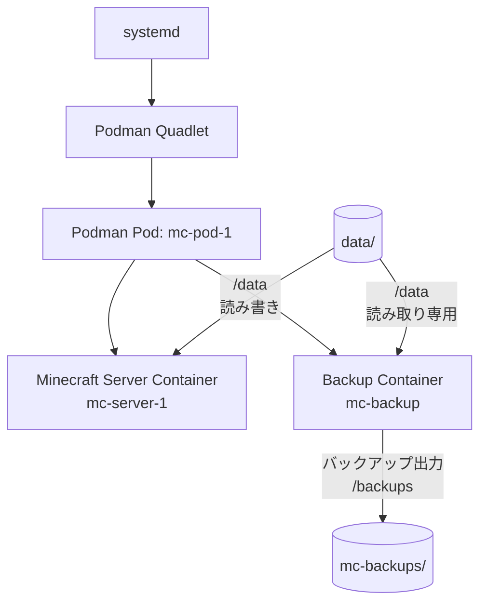
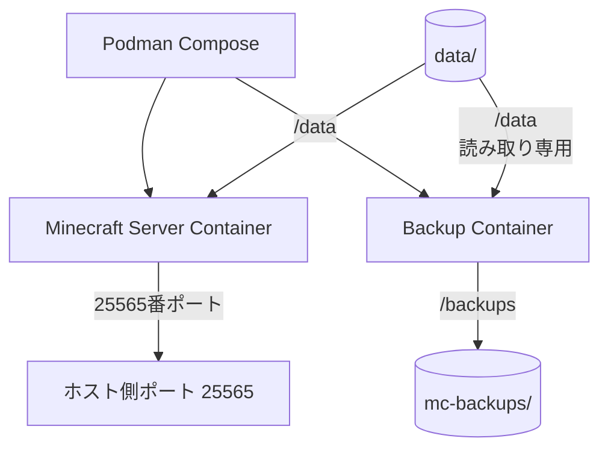

# ruhas-mc-1

Podmanを利用してMinecraftサーバーとバックアップコンテナを構成・管理するためのリポジトリです。

当初は友人のPCとのワールドデータ連携を目的として構築を始め、その後、既存の構成を利用してPodman Quadletによるコンテナ管理を学習・検証するプロジェクトへと用途を変更しました。

> [!WARNING]
> **現在、このプロジェクトのサーバー運用は停止しています。**
>
> リポジトリ内の設定ファイルやスクリプトは、構築当時の構成・検討内容を示すものです。現在の環境で正常に起動・バックアップ・復元できることは確認していません。
>
> 特にバックアップ関連スクリプトには未確認の問題があるため、実データに対して実行しないでください。

## 目的・開発背景

このプロジェクトは、Minecraftサーバーを構築し、友人のPCとの間でワールドデータを連携・共有することを目的として開始しました。

初期段階ではPodman Composeを利用してMinecraftサーバーとバックアップコンテナを管理する構成を作成しました。その後、連携先となる友人のPCが故障したことで、当初のデータ連携計画は中断しました。

計画の中断後は、既存の構成を活用し、Podman Quadletを用いたコンテナ管理方式を学習・検証する方向へ変更しました。

## 技術要素

- Linux
- Podman
- Podman Compose
- Podman Quadlet
- systemd
- コンテナイメージ
  - `itzg/minecraft-server`
  - `itzg/mc-backup`
- Bash
- tar / gzip
- SHA-256によるチェックサム検証

## 構成

### Quadlet構成

Quadletでは、systemdからPodmanコンテナを管理する構成を定義しています。



リポジトリ内の定義では、次の役割を持たせています。

| 定義ファイル | 役割 |
|---|---|
| `quadlet/mc.pod` | `mc-pod-1` Podとポート公開を定義 |
| `quadlet/mc.container` | Minecraftサーバーコンテナを定義 |
| `quadlet/mc-backup.container` | バックアップコンテナを定義 |

Minecraftサーバーコンテナとバックアップコンテナは同じPodに所属します。両コンテナはホスト上の `data/` を共有しますが、バックアップコンテナ側のマウントは読み取り専用として定義しています。バックアップの出力先にはホスト上の `mc-backups/` を指定しています。

Quadletの定義ファイルは、systemdと連携してコンテナを管理するための構成情報です。ここに記載した構成はファイル定義から読み取ったものであり、現在の環境での起動・通信・バックアップ動作を実証したものではありません。

### Compose構成

初期段階では、`compose.yml` にMinecraftサーバーとバックアップコンテナを定義していました。



Compose構成とQuadlet構成は、同じMinecraftサーバー環境を異なる方法で管理するための定義です。両方を同時に起動することを想定したものではありません。

## ディレクトリ構成

```text
ruhas-mc-1/
├── compose.yml
├── mc-pod-1.sh
├── control/
│   └── current-owner.txt
├── envs/
│   ├── minecraft.env.example
│   ├── minecraft.env
│   ├── mc-pod-1.env
│   └── mc-backup.env
├── quadlet/
│   ├── mc.pod
│   ├── mc.container
│   └── mc-backup.container
└── scripts/
    ├── pack-world.sh
    ├── create-sum.sh
    ├── check-sum.sh
    └── restore-world.sh
```

実際の運用時には、上記に加えて次のようなデータ用ディレクトリを利用する構成です。

| ディレクトリ | 用途 |
|---|---|
| `data/` | Minecraftサーバーのデータ |
| `mc-backups/` | バックアップコンテナが出力するバックアップ |
| `exports/` | `pack-world.sh` が作成するアーカイブ |
| `imports/` | `restore-world.sh` が読み込むアーカイブ |

これらのディレクトリは、リポジトリにデータ本体を含めず、実行環境側で管理する想定です。

## 環境変数

Minecraftサーバーおよびバックアップコンテナの設定には、環境変数ファイルを使用します。

### Minecraftサーバー

- Compose構成: `envs/minecraft.env`
- Quadlet構成: `envs/mc-pod-1.env`
- 設定例: `envs/minecraft.env.example`

`minecraft.env` と `mc-pod-1.env` は、キーと値を比較した結果、コメントを除いて同一でした。Quadlet構成では、Minecraftサーバー用の環境変数ファイル名を分けています。

### バックアップコンテナ

- Compose構成・Quadlet構成共通: `envs/mc-backup.env`

### 設定ファイルの取り扱い

実際の環境変数ファイルには、RCONパスワードなどの認証情報を含める可能性があります。秘密情報を含むファイルはGitにコミットせず、ローカル環境で管理してください。

`minecraft.env.example` は設定項目を確認するためのサンプルです。サンプル内の変数名や値が、現在利用しているコンテナイメージの仕様と一致することは未確認です。利用時には、使用するイメージの公式ドキュメントと照合してください。

## 起動構成に関するファイル

### `mc-pod-1.sh`

PodとMinecraftサーバー・バックアップコンテナをPodmanコマンドで作成するためのシェルスクリプトです。

Quadletの定義ファイルとは別に、Podmanコマンドを直接実行する構成が記述されています。現在の環境での実行確認は行っていません。

### `quadlet/`

systemdと連携してPodmanコンテナを管理するためのQuadlet定義ファイルを配置しています。

### `compose.yml`

初期段階で利用していたCompose構成です。ファイル内にはホームディレクトリを含むパスが記述されているため、他の環境で利用する場合はパスや環境変数ファイルの参照先を確認する必要があります。

## バックアップ・復元スクリプト

`scripts/` には、ワールドデータのアーカイブ作成、チェックサム生成・検証、復元を目的としたスクリプトを配置しています。

| スクリプト | 想定している処理 |
|---|---|
| `pack-world.sh` | ワールドデータをtar.gz形式でアーカイブし、SHA-256チェックサムを作成 |
| `create-sum.sh` | `latest.tar.gz` を対象にチェックサムを作成し、Windows側のディレクトリへコピー |
| `check-sum.sh` | チェックサムを検証した後、アーカイブを展開 |
| `restore-world.sh` | `imports/` 内のアーカイブのチェックサムを検証し、ワールドデータを展開 |

### 注意事項

これらのスクリプトは、現在の状態で安全に実行できることを確認していません。コード上、少なくとも次の確認・修正が必要です。

- `pack-world.sh` の `set -e pipefall` は、シェルオプションの指定に誤記がある可能性があります。
- `create-sum.sh` は `mc-backups/latest.tar.gz` のシンボリックリンクが存在することを前提としています。
- `create-sum.sh` には特定のWindowsユーザー環境を前提としたコピー先パスが記述されています。
- `check-sum.sh` はチェックサム検証だけでなく、アーカイブの展開も行います。
- `check-sum.sh` と `restore-world.sh` では、アーカイブの展開先が異なります。
- アーカイブ内のディレクトリ構造と、各スクリプトが想定する展開先の整合性は未確認です。

そのため、現時点ではこれらを運用手順として利用しないでください。実データを扱う前に、スクリプトの修正と、一時ディレクトリを使ったバックアップ・復元テストが必要です。

## 現在の状態と制約

- サーバー運用は停止しています。
- Minecraftサーバーの起動確認は行っていません。
- Quadletによるsystemd管理の動作確認は行っていません。
- バックアップコンテナの動作確認は行っていません。
- バックアップ・復元スクリプトの一連の動作確認は行っていません。
- コンテナイメージにはタグ `latest` を指定している箇所があり、利用時点によって取得されるイメージが変わる可能性があります。
- 設定ファイルやスクリプトは、構築当時の内容を含んでいます。

本リポジトリは、Minecraftサーバーの構成管理やPodman Quadletの学習過程を示すものです。現時点で、そのまま利用できる完成済みのサーバー運用環境としては扱わないでください。

## 参考資料

- [Podman Documentation](https://docs.podman.io/)
- [Podman Quadlet Documentation](https://docs.podman.io/en/latest/markdown/podman-systemd.unit.5.html)
- [itzg/minecraft-server](https://github.com/itzg/docker-minecraft-server)
- [itzg/mc-backup](https://github.com/itzg/docker-mc-backup)

